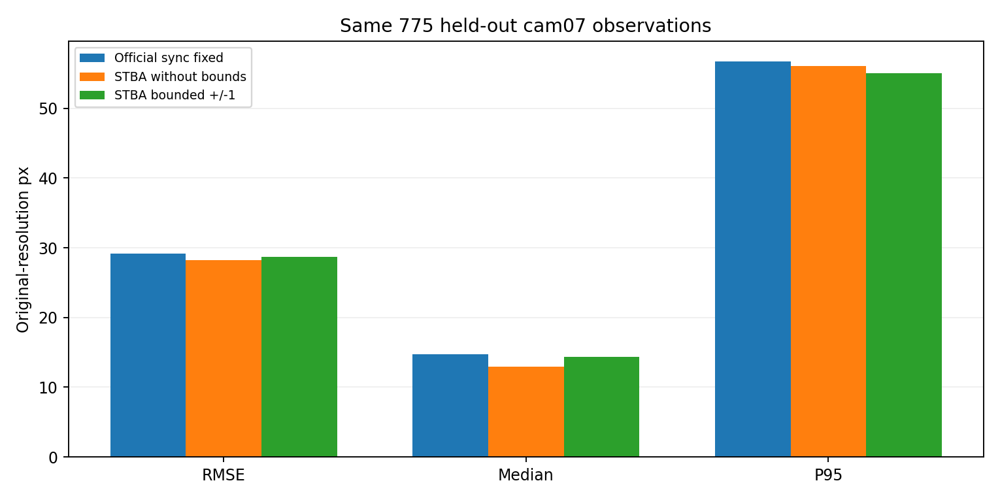

# Corgi [200,260)：剩余时间偏移 ±1 帧硬约束

在相同 **775个cam07留出目标**上，无约束RMSE为 **28.197px**，±1帧约束后为 **28.693px**；改进率 **-1.76%**（正值为改善）。
所有误差使用原始3840×2160像素坐标，1920×1080展示图像上的误差除以2。二维目标是自动检测，并非独立三维GT。

## 实际约束及代码范围

- 在上轮整帧补偿后的数据上，固定整数移帧量k，要求每路剩余 `beta_c ∈ [-1,+1]`，参考原相机04的beta固定为0。两路之间最多相差2帧。
- 使用同一8路相机、17条狗关节轨迹、60 FPS、补偿后[200,260)窗口及6795个有效二维观测。留出cam07的拟合使用其余7路5997个观测。
- 输入CSV与上一轮字节一致，官方K/D/R/T和源数据未改变。λ=4000、Huber=6 px、成对搜索半径0.6帧等设置沿用上一轮。
- 临时实现位于 `core/src/`，可审查 `bounded_core.patch`。根目录源码、根目录二进制及历史实验均不修改。
- 成对搜索与增量搜索候选区间和硬边界取交集；MST给出的初始值在求解前投影到可行域；参考相机晚加入时保持全局零基准。
- 每次Ceres求解直接设置参数上下界，并在各次迭代检查范围；全局续算也使用同一个有界核心。不是在最终CSV上裁剪offset。
- 配置项为 `offset_bound_frames: 1`。临时实现要求参考beta=0；设为0可禁用约束。

## 同目标比较

| 方法 | RMSE px | 中位数 px | P95 px |
|---|---:|---:|---:|
| 固定官方余量 | 29.132 | 14.693 | 56.755 |
| STBA无硬约束 | 28.197 | 12.960 | 56.052 |
| STBA ±1帧硬约束 | 28.693 | 14.354 | 55.089 |

cam07完全不参与时间估计或三维轨迹拟合；预测其二维点时保持cam07官方时钟。要求目标时刻至少两路有效连续源观测，且不外推轨迹。上述表格使用有界/无界及固定基线均有效的相同目标集合，没有按几何误差删点。
相机和关节选择沿用既有实验。这是一个短片段的留出视角比较，不代表跨片段泛化，也不提供毫米级三维精度或真实同步误差。

## 最终8路余量

| 原相机 | 无约束（帧） | ±1约束（帧） | 到达硬边界 |
|---|---:|---:|---|
| 04 | +0.000000 | +0.000000 | 否 |
| 07 | +0.135667 | +0.407903 | 否 |
| 10 | +1.340035 | +1.000000 | 是 |
| 13 | -0.000000 | -0.098628 | 否 |
| 16 | -0.174548 | +0.161541 | 否 |
| 18 | -1.281637 | -0.838519 | 否 |
| 21 | -0.427501 | -0.444326 | 否 |
| 23 | -0.447615 | -0.598806 | 否 |

8路最终最大绝对余量：**1.000000帧**；最大最小差：**1.838519帧**。±1是相对base的限制，不是任意两路差值≤1。
留出07的7路求解最大绝对余量：**1.000000帧**。
恢复到原始视频帧号时，完整偏移为 `beta_total = integer_shift + estimated_residual`，见 `offsets.csv`。

## 优化状态与核验

- 8路/baseline：`Global: Ceres Solver Report: Iterations: 32, Initial cost: 4.676886e+07, Final cost: 4.871438e+05, Termination: CONVERGENCE`
- 8路/result：`Global: Ceres Solver Report: Iterations: 9, Initial cost: 4.413491e+05, Final cost: 4.413491e+05, Termination: CONVERGENCE`
- 留出07的7路/baseline：`Global: Ceres Solver Report: Iterations: 41, Initial cost: 4.397578e+07, Final cost: 4.168905e+05, Termination: CONVERGENCE`
- 留出07的7路/result：`Global: Ceres Solver Report: Iterations: 78, Initial cost: 3.799541e+05, Final cost: 3.799265e+05, Termination: CONVERGENCE`

初次求解最多200步；未收敛时仅按求解状态续算，不按留出误差挑选中间结果。实际命令、迭代数和采用的结果目录保存在 `*.command.json` 与 `selected_results.json`。
原核心测试和新增约束测试均通过。合成案例无约束解的beta约0.850，限制±0.5后停在0.500；还测试了参考相机最后加入、非法初值拒绝、观测覆盖和相机参数不变。
`*.bounds.csv` 保存各阶段及Ceres迭代的范围；`*.bounds_check.json` 和 `validation.json` 汇总检查。完整CSV输入与输出的相机参数数值差为0。
此实现仍保留原STBA的事件顺序限制及近重合事件冻结行为；加边界不等于证明求得全局最优。

## 结果入口

- [无约束/有约束比较图](plots/previous_comparison.png)、[指标总览](plots/summary.png)。
- [三方法留出视角视频](plots/heldout07.mp4)、[第230帧对照](plots/heldout07_230.jpg)。绿点为二维检测，紫色为其他相机恢复的三维点投影。
- [三维骨架视频](plots/skeleton.mp4)、[第230帧骨架](plots/skeleton_230.png)、[离散STBA与DCT轨迹](plots/trajectories.png)。
- [三维CSV](reconstruction.csv)、[三维NPZ](reconstruction.npz)、[时间偏移表](offsets.csv)、[数值JSON](summary.json)。
- 视频为15 FPS展示原60 FPS，共60帧，四分之一速度。三维点为稀疏17关节，不是稠密点云。
- 构建：`cmake -S core -B core/build -DCeres_DIR=/opt/ceres-2.2/lib/cmake/Ceres -DCMAKE_BUILD_TYPE=Release`，再 `cmake --build core/build -j4`；refine同样独立构建。
- 使用 `tmp/walking_stba/venv/bin/python` 执行 `run.py solve all8` / `run.py solve holdout07`，必要时 `run.py continue ...`，最后执行 `analyze.py`。求解拒绝覆盖已有结果。

