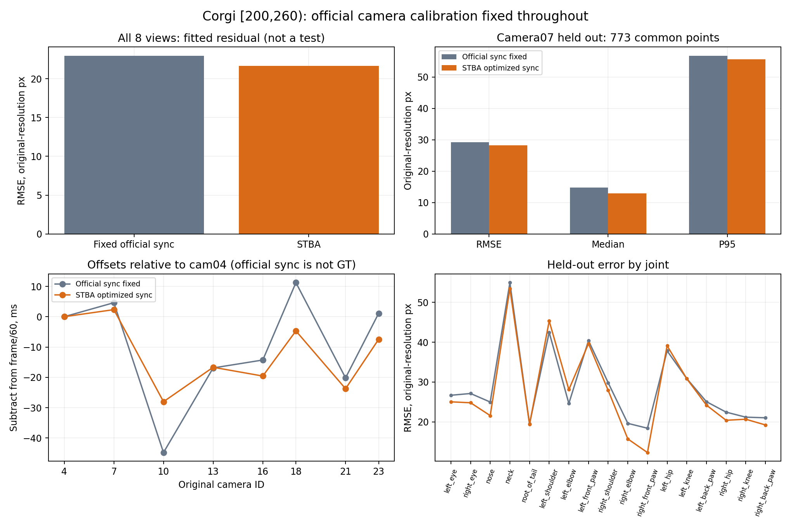

# Corgi 200–260 帧：固定相机内外参 STBA 实验

- 窗口 **[200,260)**，原始 60 FPS，200–259 共 60 帧；不使用 30 FPS 衍生视频。
- 使用原相机 **04、07、10、13、16、18、21、23**，狗的 **17 个 APT36K 关节点**；有效二维观测 **6807/8160**。
- 直接沿用官方原始分辨率 K、Rodrigues R、T 和 D。输入与全部输出 K/R/T 数值完全相等；D 用于去畸变及回投影，不参与优化。
- 官方 YAML 的 Rot 矩阵与其 R 旋转向量存在约 3e-8 的舍入差；采用官方 R 原值，不重新拟合旋转。
- 初始时间来自官方 sync.json，参考 cam04；full 模式估计时间与轨迹，fixed 基线只估轨迹。
- λ=4000、Huber=6 原分辨率 px，等效于先前半分辨率 λ=1000、Huber=3 px；参数未按本次误差挑选。
- 这是稀疏骨架/轨迹实验，不是动态稠密点云重建。没有独立三维或曝光时间 GT，不能报告毫米精度。

## 数值结果

**以下误差均为原始 3840×2160 像素坐标；换算成 1920×1080 展示图像误差需除以 2。**

| 评价 | 固定官方同步 | STBA 优化同步 |
|---|---:|---:|
| 全 8 路拟合 RMSE（带畸变回投影，px） | 22.946 | 21.652 |
| 留出 cam07 RMSE（px） | 29.237 | 28.283 |
| 留出 cam07 中位数（px） | 14.789 | 12.929 |
| 留出 cam07 P95（px） | 56.728 | 55.611 |
| 留出 cam07 DCT RMSE（px） | 28.854 | 27.903 |

留出评价采用同一批 **773/798** 个有效目标。cam07 的二维观测从时间估计与轨迹拟合中完全排除；其评价时钟固定为官方 sync。要求目标时刻至少两路连续有效源观测，并且不外推轨迹。DCT 误差含导出网格线性插值误差。

这能检验对留出视角二维检测的预测，但检测器也可能错配左右肢体或预测遮挡点。既有相机选择参考过第230帧可见性，同一时间窗用于拟合及留出视角检查，不能称为盲测、独立三维精度或跨时间泛化验证。

## 优化状态

初次全局优化均达到200步上限，原结果保存在 `result/`。仅按未收敛状态对两组均从已保存XYZ/时间偏移续算最多1000步；使用当前根目录同一 `libstba_core.a`，不重跑成对搜索、不更改目标或相机参数。最终采用 `result_refined/`，不按留出误差挑选迭代结果。

- 8路重建 / Official sync fixed：`Global: Ceres Solver Report: Iterations: 32, Initial cost: 4.645970e+07, Final cost: 4.835702e+05, Termination: CONVERGENCE`
- 8路重建 / STBA optimized sync：`Global: Ceres Solver Report: Iterations: 398, Initial cost: 4.243116e+05, Final cost: 4.242026e+05, Termination: CONVERGENCE`
- 7路拟合、留出07 / Official sync fixed：`Global: Ceres Solver Report: Iterations: 41, Initial cost: 4.373385e+07, Final cost: 4.140572e+05, Termination: CONVERGENCE`
- 7路拟合、留出07 / STBA optimized sync：`Global: Ceres Solver Report: Iterations: 603, Initial cost: 3.594674e+05, Final cost: 3.590104e+05, Termination: CONVERGENCE`

## 8路估计时间

| 原相机 | 官方相对修正 ms | STBA 修正 ms |
|---|---:|---:|
| 04 | +0.000 | +0.000 |
| 07 | +4.617 | +2.334 |
| 10 | -44.779 | -28.012 |
| 13 | -16.887 | -16.667 |
| 16 | -14.272 | -19.559 |
| 18 | +11.235 | -4.679 |
| 21 | -20.162 | -23.738 |
| 23 | +1.123 | -7.437 |

公式为 `t=frame/60-offset`。与官方修正的差不能称为真实同步误差。

## 查看与复现

- [三维骨架图](plots/skeleton_230.png)、[三维骨架视频](plots/skeleton.mp4)、[STBA/DCT轨迹图](plots/trajectories.png)。
- [留出07对照图](plots/heldout07_230.jpg)、[留出07对照视频](plots/heldout07.mp4)、[数值概览](plots/summary.png)。视频均按15 FPS展示，原60 FPS片段为四分之一速度。
- [输入](input/)、[STBA输出](result_refined/)、[固定同步基线](baseline/)、[统一参考时刻的三维CSV](reconstruction.csv)、[NPZ](reconstruction.npz)。
- `frames/` 为所选480张半分辨率原图的只读来源链接；没有覆盖或修改数据源。`frame_manifest.csv` 保留来源路径。
- `summary.json`、`holdout07/predictions.npz`、`*.command.json`、日志和标定校验文件保留数值及实际运行命令。
- 使用仓库根目录当前 `build/stba`，非旧实验副本。`manifest.json` 记录二进制和输入来源 SHA256。
- 用 `tmp/walking_stba/venv/bin/python run.py prepare` 提取，再分别 `run.py solve all8`、`run.py solve holdout07`；构建 `refine/` 后分别 `run.py continue all8`、`run.py continue holdout07`，最后 `analyze.py`。实际路径/参数见 command JSON。提取与求解拒绝覆盖已有结果。

