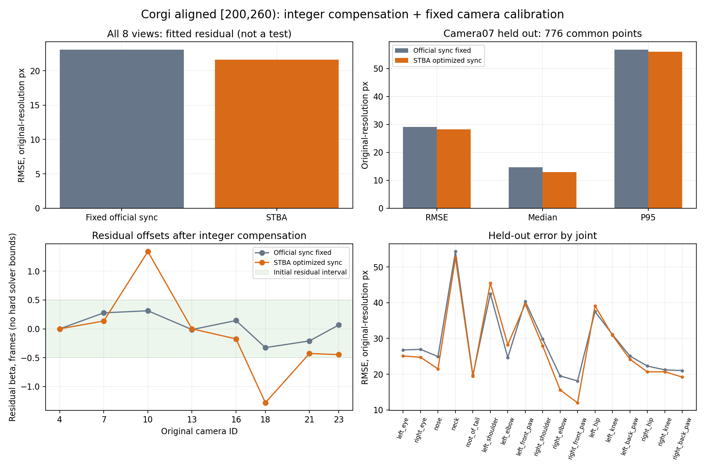

# Corgi：整帧预补偿后，对齐窗口 [200,260) 的 STBA 实验

以原相机04为 base。8路原始偏移跨度 **3.360888帧**，预补偿后剩余偏移跨度 **0.639112帧**，最大绝对余量 **0.325873帧**。相机内外参固定。

## 补偿方法

`beta_c = 60 * (sync[c] - sync[04])`，`k_c = round(beta_c)`，`r_c = beta_c - k_c`。
把原始帧 `f` 重编号为 `g=f-k_c`，STBA输入为 `(g,r_c)`；满足 `(f-beta_c)/60 = (g-r_c)/60`。对齐后截取 `g∈[200,260)`，因此每路实际读取的原始帧不同。没有插值或复制图像来填帧。

| 原相机 | 原beta（帧） | 整帧k | 剩余r（帧） | 实际原始帧区间 |
|---|---:|---:|---:|---|
| 04 | +0.000000 | +0 | +0.000000 | [200,260) |
| 07 | +0.277003 | +0 | +0.277003 | [200,260) |
| 10 | -2.686761 | -3 | +0.313239 | [197,257) |
| 13 | -1.013246 | -1 | -0.013246 | [199,259) |
| 16 | -0.856335 | -1 | +0.143665 | [199,259) |
| 18 | +0.674127 | +1 | -0.325873 | [201,261) |
| 21 | -1.209740 | -1 | -0.209740 | [199,259) |
| 23 | +0.067410 | +0 | +0.067410 | [200,260) |

- 窗口为补偿后的 **[200,260)**，原始60 FPS，各路60张图像。24路同步拆分也保存在 `sync_alignment_all24.csv`，本次STBA仍使用与上一轮相同的8路。
- 使用原相机 **04、07、10、13、16、18、21、23**，狗的 **17个APT36K关节点**；有效二维观测 **6795/8160**。
- 直接沿用官方原始分辨率 K、Rodrigues R、T 和 D。输入与全部输出 K/R/T 数值完全相等；D 用于去畸变及回投影，不参与优化。
- 官方 YAML 的 Rot 矩阵与其 R 旋转向量存在约 3e-8 的舍入差；采用官方 R 原值，不重新拟合旋转。
- 初始时间采用整帧补偿后的官方小数余量，参考cam04；full模式估计余量与三维轨迹，fixed基线固定官方余量，只估轨迹。
- λ=4000、Huber=6 原分辨率 px，等效于先前半分辨率 λ=1000、Huber=3 px；参数未按本次误差挑选。
- 这是稀疏骨架/轨迹实验，不是动态稠密点云重建。没有独立三维或曝光时间 GT，不能报告毫米精度。

## 同观测等价性核验

对上一轮同一批6807个物理观测，仅重编号帧号并同步减去整帧beta，固定时间求解的时间、XYZ、重投影误差与目标函数均与上一轮完全一致，差值为0，见 `equivalence/verification.json`。上一轮已使用完整官方sync，不存在忽略整帧offset的问题。本次增加的是对齐取帧窗口；不同结果还会受到窗口端点和非凸搜索路径影响。

## 数值结果

**以下误差均为原始 3840×2160 像素坐标；换算成 1920×1080 展示图像误差需除以 2。**

| 评价 | 固定官方同步 | STBA 优化同步 |
|---|---:|---:|
| 全 8 路拟合 RMSE（带畸变回投影，px） | 23.060 | 21.632 |
| 留出 cam07 RMSE（px） | 29.129 | 28.186 |
| 留出 cam07 中位数（px） | 14.700 | 12.968 |
| 留出 cam07 P95（px） | 56.738 | 56.051 |
| 留出 cam07 DCT RMSE（px） | 28.794 | 27.698 |

留出评价采用同一批 **776/798** 个有效目标。cam07 的二维观测从时间估计与轨迹拟合中完全排除；其评价时钟固定为官方 sync。要求目标时刻至少两路连续有效源观测，并且不外推轨迹。DCT 误差含导出网格线性插值误差。

这能检验对留出视角二维检测的预测，但检测器也可能错配左右肢体或预测遮挡点。既有相机选择参考过第230帧可见性，同一时间窗用于拟合及留出视角检查，不能称为盲测、独立三维精度或跨时间泛化验证。

## 与上一轮的同目标比较

再次取前后两次共同有效的 **773个cam07目标**，避免覆盖集合变化影响比较。
| 方法 | RMSE px | 中位数 px | P95 px |
|---|---:|---:|---:|
| 上一轮：固定官方完整offset | 29.237 | 14.789 | 56.728 |
| 上一轮：STBA | 28.283 | 12.929 | 55.611 |
| 本次：对齐取帧+固定官方余量 | 29.180 | 14.725 | 56.788 |
| 本次：对齐取帧+STBA | 28.239 | 12.983 | 56.054 |

## 优化状态

运行相同的成对搜索、MST、增量、全局优化与DCT。初次迭代上限200；达到上限时从保存的XYZ及offset继续最多1000步。留出07的全局求解仍未收敛，随后给最多2000步，实际在499步收敛。使用根目录同一libstba_core.a，不修改目标或相机参数，也不按留出误差选结果。实际输出目录见summary.json及selected_results.json。

- 8路重建 / Official sync fixed：`Global: Ceres Solver Report: Iterations: 32, Initial cost: 4.676886e+07, Final cost: 4.871438e+05, Termination: CONVERGENCE`
- 8路重建 / STBA optimized sync：`Global: Ceres Solver Report: Iterations: 666, Initial cost: 4.234121e+05, Final cost: 4.233800e+05, Termination: CONVERGENCE`
- 7路拟合、留出07 / Official sync fixed：`Global: Ceres Solver Report: Iterations: 41, Initial cost: 4.397578e+07, Final cost: 4.168905e+05, Termination: CONVERGENCE`
- 7路拟合、留出07 / STBA optimized sync：`Global: Ceres Solver Report: Iterations: 499, Initial cost: 3.577762e+05, Final cost: 3.577614e+05, Termination: CONVERGENCE`

## 8路估计时间

| 原相机 | 官方余量（帧） | STBA余量（帧） | 恢复原始帧号的总beta |
|---|---:|---:|---:|
| 04 | +0.000000 | +0.000000 | +0.000000 |
| 07 | +0.277003 | +0.135667 | +0.135667 |
| 10 | +0.313239 | +1.340035 | -1.659965 |
| 13 | -0.013246 | -0.000000 | -1.000000 |
| 16 | +0.143665 | -0.174548 | -1.174548 |
| 18 | -0.325873 | -1.281637 | -0.281637 |
| 21 | -0.209740 | -0.427501 | -1.427501 |
| 23 | +0.067410 | -0.447615 | -0.447615 |

初始余量的跨度小于一帧。沿用原STBA实现，未添加优化过程的硬边界；不能把初始跨度保证等同于优化后仍小于一帧。
8路最终余量跨度为 **2.621673帧**，最大相对base绝对值 **1.340035帧**。
原始帧上的总偏移必须恢复为 `beta_total=k+r_estimated`，禁止直接拿余量当原始视频的完整offset。官方sync是参考，不是独立时间GT。

## 查看与复现

- [三维骨架图](plots/skeleton_230.png)、[三维骨架视频](plots/skeleton.mp4)、[STBA/DCT轨迹图](plots/trajectories.png)。
- [留出07对照图](plots/heldout07_230.jpg)、[留出07对照视频](plots/heldout07.mp4)、[数值概览](plots/summary.png)。视频均按15 FPS展示，原60 FPS片段为四分之一速度。
- [输入](input/)、[STBA输出](result_refined/)、[固定同步基线](baseline/)、[统一参考时刻的三维CSV](reconstruction.csv)、[NPZ](reconstruction.npz)。
- `frames/` 按对齐帧号命名，指向各相机对应的原始半分辨率图像；`frame_manifest.csv` 保留原始/对齐帧号及完整映射。数据源和上一轮结果未修改。
- [上一轮比较图](plots/previous_comparison.png)、[时间偏移和原始帧映射](offsets.csv)、[24路整帧拆分](sync_alignment_all24.csv)。
- `summary.json`、`holdout07/predictions.npz`、`*.command.json`、日志和标定校验文件保留数值及实际运行命令。
- 使用仓库根目录当前 `build/stba`，非旧实验副本。`manifest.json` 记录二进制和输入来源 SHA256。
- 用 `tmp/walking_stba/venv/bin/python run.py prepare` 提取，再分别 `run.py solve all8`、`run.py solve holdout07`；构建 `refine/` 后分别 `run.py continue all8`、`run.py continue holdout07`，最后 `analyze.py`。实际路径/参数见 command JSON。提取与求解拒绝覆盖已有结果。

- 本次holdout07另续算：`run.py continue holdout07 --source result_refined --out result_refined2 --iterations 2000`。它仅由未收敛状态触发。之后重新运行 `analyze.py`。

