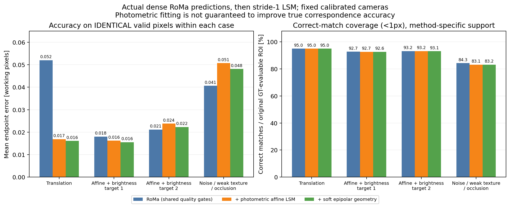

# RoMa → 固定相机 LSM：实际实验报告

本实验已实现并运行两视图稠密精化、合成真值验证、真实静态 ROI 验证，以及三个共视相机的共享深度四权重实验。**LSM 有条件有效，但不能作为保证改善 RoMa 的通用后处理。** 相机参数固定，没有运行 STBA、估计时间偏移、构建稀疏轨迹或训练网络。

## 1. 数据、实现与验证

- 真实数据：SelfCap `corgi-release` 的原始帧 230，相机 07→09、07→10。工作图像 480×270，每相机统一去畸变一次；同帧号不视为同步。采用 `asynchronous_unknown`，只在人工检查的静态地面掩膜内处理，参考/目标整个 patch 都必须有效。参考 ROI 为 22,090 个像素，stride=1。见 [静态掩膜](data/static_masks.png) 与 [数据清单](data_manifest.json)。
- 由相机中心距离及实际共视情况选视图：两条基线为 0.58743、1.36694 **数据集原生公共单位**，没有独立验证其米制尺度。较小编号差不代表较近相机。
- 合成数据：192×144、三个已知标定相机；独立射线与平面相交，连续世界纹理按每像素 4×4 子采样积分。包含平移、仿射/亮度变化，以及噪声/弱纹理/真实遮挡；不是用优化器的双线性插值直接生成目标图。每对参考 ROI 24,388 像素。正式网络和 LSM 使用同一组 PNG；另外的受控优化器验证使用浮点渲染图。
- 匹配器为 **RoMa v1 0.1.2**，来源提交 `77f8d68803526dcddfd9b7a46bc76125bdc25f15`。权重为 `roma_outdoor.pth`、`dinov2_vitl14_pretrain.pth`；权重 SHA、实际源码 SHA、软件版本、GPU 和配置见 [provenance](cache/provenance.json)。本地包包含扩展选项，本实验明确关闭 padding/compile，未混用 RoMa v2。推理 coarse/upsample 均为 560。
- 保留完整原生 `[1,560,1120,4]` 双向 warp 和 certainty，再解码到工作图像规则网格；没有调用 `sample()` 获得稀疏主体。certainty 仅当模型评分。
- 坐标为 `(x,y)`、零起始整数像素中心；归一化 `g=2*(u+0.5)/size-1`，`align_corners=False`。每幅图分别变换尺寸/K；每相机保存回原始畸变坐标的映射。外参 `Xc=R Xw+t`，`C=-Rᵀt`。F 仅由固定标定计算，约定 `qᵀFp=0`。
- PyTorch 分块批量 LM，translation 优化中心位移/gain/bias；affine 再优化局部 2×2 矩阵。默认 patch=11、15 次迭代、batch=512、最大中心修正=4 工作像素。光度和极线残差分别归一化，Huber，软几何 `sigma_epi=1, lambda_epi=0.1`。参数见 [config.json](config.json)。
- 质量检查包括边界、双向误差、评分、纹理、正规方程条件数、位移、仿射奇异值/行列式、光度和收敛；失败单独记录，不填洞，不把回退原值算成功。仿射初值从可靠 RoMa 邻域拟合，不可靠时用单位阵。
- **40 项单元测试全部通过**：坐标/尺寸、投影/F、数值 Jacobian、已知位移/仿射/亮度、退化/边界/NaN、共享深度与权重、统计分母/回退等。见 [unit_tests.log](unit_tests.log)。另有 5 项 RoMa 适配检查及原畸变坐标往返检查，最大往返误差约 `2e-7 px`。
- 独立检查 6 对、30 份方法输出、323,249 个接受的精化像素：原始 RoMa 保持位级一致、标定源哈希未变、成功标志/参数范围/静态 patch 全通过。见 [audit.json](audit.json)。

## 2. 第一阶段：实际 RoMa 初始化

A0 是经过共同评分/FB/patch 检查的原始 RoMa；A1 是仿射光度 LSM；A2 再加入固定标定软极线项。另运行 A1_translation 与 A0g（仅投影到固定极线的控制组）。所有方法读取同一份网络缓存。各 `metrics.json/csv` 同时保存**未筛选原始模型、各自有效域、全部五方法共同域、A0/A1/A2 共同域**，不把筛选效应混作优化收益。

### 有 GT 的对应误差

以下 EPE 均值单位为工作像素，**每行三个方法用完全相同的像素**。覆盖率另以原始 `reference_roi ∩ valid_gt` 为分母，不随方法筛选改变。

| 合成场景 | 共同像素 | A0 | A1 仿射 | A2 仿射+几何 | 各自有效覆盖率 A0 / A1 / A2 |
|---|---:|---:|---:|---:|---:|
| 平移 | 22,401 | 0.05205 | 0.01687 | 0.01610 | 94.98% / 94.98% / 94.98% |
| 仿射/亮度，目标 1 | 21,069 | 0.01801 | 0.01622 | 0.01553 | 92.73% / 92.65% / 92.64% |
| 仿射/亮度，目标 2 | 21,720 | 0.02116 | 0.02378 | 0.02229 | 93.21% / 93.16% / 93.13% |
| 噪声/弱纹理/遮挡 | 19,613 | 0.04066 | 0.05074 | 0.04814 | 84.31% / 83.20% / 83.25% |



结论：平移明显改善，目标 1 小幅改善，另两组反而恶化。A2 相比 A1 在这四组均略好，但没有保证优于 A0。A2 接受结果中，相比同像素原始 RoMa 误差扩大的比例依次为 **0.96%、44.28%、53.29%、51.61%**。这些值保留了原始预测已经很准时的退化。

平移模型在平移场景 EPE 为 0.01530；在两个仿射场景约为 0.09856、0.07335，说明模型不匹配会明显损害定位。A0g 在仿射目标 1/2 和复杂场景约为 0.01292/0.01309/0.02898，比完整 LSM 更低：在这些**精确标定的合成条件**下，几何校正本身已有收益，不能把全部收益归因于光度优化。

均值/中位数/P90、`<0.5/1/2 px` 比例和正确覆盖率、各区域与失败原因完整保存于每对 `metrics.json/csv`。未筛选原始 RoMa 的 ROI EPE 均值分别为 0.05209、0.02051、0.02313、0.05498；它们与表中筛选后 A0 不混用。

### 真实静态区域：只解释诊断指标

下面同样使用 A0/A1/A2 共同域。光度为归一化灰度 patch RMSE；FB 是前向结果查询**同一个固定原始反向 RoMa 场**的误差，前后都不重估反向场。它有独立反向预测的偏差，并非 GT。

| 相机对 | 共同像素 | 光度 A0 → A1 → A2 | FB 均值 A0 → A1 → A2（px） | 极线距离 A0 → A1 → A2（px） |
|---|---:|---:|---:|---:|
| 07→09 | 13,963 | .01405 → .00884 → .00886 | .04277 → .10147 → .09544 | .05563 → .08318 → .04976 |
| 07→10 | 9,094 | .02353 → .00727 → .00728 | .06624 → .10497 → .09445 | .06432 → .07370 → .05272 |

07→09 有效数 A0/A1/A2 为 15,242/14,395/14,544；07→10 为 10,002/9,370/9,420。分母均为 22,090 的参考静态 ROI，损失既包含目标视图重叠/边界限制，也包含匹配与优化筛选。

仿射 LSM 降低光度，软几何降低极线距离，但 FB 比原始预测更高。**这不能证明真实亚像素准确度或三维精度提高。** 同样，A0g 的近零极线残差只是构造结果。实景照明/阴影、局部仿射近似、标定偏差与反向场偏差均可能影响这些诊断，本实验没有用未知真实 GT 选择解释。

## 3. 受控初值验证：与 RoMa 性能分开

[optimizer_checks](results/optimizer_checks/metrics.json) 共 36 组：3 场景 × 初始误差 0.5/2/6 px × translation/affine × 几何 off/on；每组 stride=1 的 64×48 ROI（3,072 像素），共 110,592 次尝试。这些初值由 GT 加扰动构造，**仅用于优化器验证，不冒充网络输出**，GT 可见性不参与优化接受条件。

- 平移、0.5 px 初误差：100% 接受，误差约 0.013–0.015 px。
- 仿射/亮度、0.5 px 初误差：共同 3,059 像素，translation 0.1042 px，affine 0.0145 px，affine+几何 0.0139 px。
- 复杂场景、0.5 px 初误差：共同 1,833 像素，affine 0.1420 px，affine+几何 0.1263 px；自身成功覆盖率约 65.5%，`<1px` 正确覆盖率约 64.97%。大量弱纹理被拒绝，遮挡也仍可能漏检。
- 初误差 6 px 超出当前修正范围：所有方法 `<1px` 正确覆盖率均为 0。少量错误局部解仍能通过质量检查，因此检查不是正确对应的保证；此时共同域极小，不能据其均值推广。

## 4. 第二阶段：共享单位射线深度与四种冻结权重

第一阶段测试/真实与合成双视图运行通过后才执行，见 [stage1_gate.json](stage1_gate.json)。一个参考像素对应一个正的单位射线距离 `d`，两目标中心均为 `project(C+d*ray)`；固定第一阶段 A1 的局部 A，只优化 `log(d)` 和各视图 gain/bias，没有独立二维中心自由度。

四组使用相同 A1 共同有效像素、相同两对正深度均值初值，权重在内部优化中冻结。质量是 `clip(score*exp(-0.5*(FB/1.5)^2)*exp(-0.5*(photo/0.05)^2),0.05,1)`；距离是 `clip(exp(-(B/median(B))^2),0.2,1)`；各组最后归一化为权重和 2。所有分量保存，未用 GT 调权。

**对独立 pair 的整个目标乘固定正标量不会改变最优解。** 本实验的权重作用于共同深度的两个视图残差，确实改变了解；不是给独立两视图 LSM 加一个无效常数。

合成三视图：尝试 18,957 个像素，四组共同有效 18,930；原始两目标都 GT 可见的 ROI 为 21,728。以下均在相同共同域；深度单位在此合成场景确认为米，表中换算成毫米。

| 权重 | 单位射线距离 RMSE（mm） | 目标1 / 目标2 EPE（px） | 自身有效像素 |
|---|---:|---:|---:|
| 相同共享深度初值 | **2.919** | .006635 / .008302 | 18,930（本表共同域） |
| uniform | 2.970 | .006733 / .008424 | 18,950 |
| quality | 3.268 | .007407 / .009267 | 18,948 |
| distance | 2.886 | .006543 / .008186 | 18,944 |
| quality_distance | 2.884 | .006540 / .008183 | 18,949 |

在这个单一合成场景中，距离权重优于纯质量；联合权重与纯距离几乎相同（RMSE 相差约 0.0025 mm）。但**相对已有共享深度初值，改善仅约 1.2%；uniform 和 quality 反而更差**。二维 EPE 比独立 A1 更低包含共同几何投影的贡献，不能全算作光度优化收益。没有重复种子/独立场景统计，不能宣称普适优势。

见 [四权重与投影初值对比图](results/multiview/multiview_comparison.png)。[多视图审计](multiview_audit.json) 确认四组初始化字节一致、权重可精确重算且冻结、局部 A 与第一阶段相同、成功点深度为正、三个视图完整 patch 均在有效静态区域内、相机参数一致；共享深度重投影与保存中心误差小于 `5e-4 px`。

真实 07/09/10：共同 A1 输入 6,241 像素；uniform/quality/distance/联合各接受 6,113/6,117/6,092/6,084，四组共同 5,846，仅占原参考静态 ROI 的 26.46%。在相同共同域，较远目标10的 FB 从 uniform 的 .10972 增至 distance 的 .14012、联合的 .14768 px；没有真实深度 GT，不能宣称距离加权提高三维精度。完整射线交会角、深度可观测性、权重和状态在 [多视图结果](results/multiview/) 中。

## 5. 代价、输出与最小下一步

正式运行单张 RTX 4090（物理 GPU5），阶段间顺序执行，网络缓存被所有消融复用。6 对网络推理合计 6.93 s（含首次暖机，单次 .24–4.30 s，模型加载另记），PyTorch 峰值 allocated 约 2.73 GiB。18 次正式 pairwise LSM 合计 93.84 s，单次 2.56–8.66 s，LSM 峰值 allocated 约 19.05 MiB；受控优化器验证另耗 55.46 s。它们是对应阶段的张量显存，不含整个进程/CUDA 上下文，也不是完整系统显存。GPU 计时前后同步；筛选/保存/推理/解码分别记入各 meta/cache JSON。

主要瓶颈是逐批迭代、四次回溯和重复 patch/Jacobian 计算，尚未融合 kernel；本实验重点是正确性和可审计性。当前纹理是有限复杂度的合成平面，真实测试也只有一帧静态背景，不能外推到异步运动物体、整段视频或完整稠密表面。

最小下一步：保持这些缓存、相机和评估分母不变，在独立噪声种子上比较**亮度补偿后的初始光度质量**与当前未补偿质量分数，再看共享深度是否稳定优于相同投影初值。当前质量权重受 gain/bias 差异影响，不能直接解释为测量方差。真实精度验证需要独立静态几何/对应 GT；仅继续减小极线残差不足以回答。

每个 pair 的五份 NPZ 保存原始/精化对应、有效/尝试/成功掩膜、几何适用性、状态、置信度、位移、前后 photo/FB/epi、A/gain/bias 和可用时的三角化诊断；`meta.json` 保存坐标、stride、参数、相机、计时。`plots/` 有置信度、位移、有效/失败地图、空间确定性抽样 patch、目标 warp 误差、合成 GT 的 CDF/EPE 图；没有按 GT 挑选“好看”的样例。

优先查看：[汇总图](results/summary.png)、[真实 patch 对比](results/real_7_9/plots/patch_examples.png)、[真实质量/失败图](results/real_7_10/plots/quality_maps.png)、[合成 EPE 对比](results/synthetic_affine_brightness_0_2/plots/synthetic_epe_cdf.png)。运行日志为 `roma_*.log`、`experiment.log`、`optimizer_checks.log`、`multiview_experiment.log`、`evaluation_visualization.log`。

## 6. 复现命令

在仓库根目录执行，环境为现有 `/data/tools/miniconda3/envs/roma_corr`。GPU 编号应选本机空闲卡；当前实际使用 5。代码没有自动下载或替换模型。已有输入和缓存可以直接从测试/experiment 开始。

```bash
export ROMA_PY=/data/tools/miniconda3/envs/roma_corr/bin/python
export CUDA_VISIBLE_DEVICES=5
export MPLCONFIGDIR=/tmp/roma_lsm_matplotlib

# 数据与坐标检查；准备数据不会修改标定源文件。
$ROMA_PY experiments/roma_lsm/prepare_data.py
$ROMA_PY experiments/roma_lsm/synthetic.py
$ROMA_PY experiments/roma_lsm/data_checks.py
$ROMA_PY -m unittest discover -s experiments/roma_lsm/tests -v

# 真实 RoMa；命中来源校验的缓存时跳过重复推理。
$ROMA_PY experiments/roma_lsm/roma_adapter.py
# 合成的三份 roma_manifest.json 已随实验保存。
for case in translation affine_brightness occlusion_weak_noise; do
  $ROMA_PY experiments/roma_lsm/roma_adapter.py \
    --manifest experiments/roma_lsm/data/synthetic/$case/roma_manifest.json \
    --out experiments/roma_lsm/cache/synthetic_$case
done

$ROMA_PY experiments/roma_lsm/experiment.py --selection all --device cuda --evaluate
$ROMA_PY experiments/roma_lsm/run_optimizer_checks.py --device cuda
# 仅在上述第一阶段测试与结果检查通过后运行：
$ROMA_PY experiments/roma_lsm/multiview_experiment.py --selection all --device cuda
$ROMA_PY experiments/roma_lsm/audit_results.py
$ROMA_PY experiments/roma_lsm/audit_multiview.py

for pair in experiments/roma_lsm/results/real_* experiments/roma_lsm/results/synthetic_*; do
  $ROMA_PY experiments/roma_lsm/evaluate.py "$pair"
  $ROMA_PY experiments/roma_lsm/visualize.py "$pair"
done
$ROMA_PY experiments/roma_lsm/summary_plot.py
```

`config.json` 是示例中央配置；每次结果均另存实际参数。`run_optimizer_checks.py` 的受控配置另外完整保存在其输出目录。阶段二只输出参考网格上的辅助深度和对应，不是完整 MVS/网格重建。
